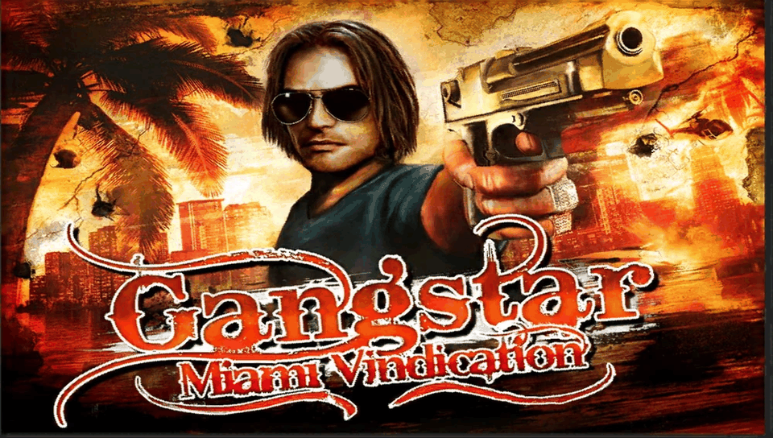

<h1 align="center">
  <br>
  Gangstar Miami Vindication · PS Vita Port
</h1>

<p align="center">
  <b>Native port of Gangstar Miami Vindication HD (Gameloft) for PlayStation Vita and PlayStation TV.</b>
</p>

<p align="center">
  
  
  
  
  
  
</p>

<p align="center">
  <a href="#-description">Description</a> •
  <a href="#-features">Features</a> •
  <a href="#-controls">Controls</a> •
  <a href="#-installation">Installation</a> •
  <a href="#-known-issues">Known Issues</a> •
  <a href="#-building-from-source">Build</a> •
  <a href="#-credits">Credits</a>
</p>

---

## 📖 Description

**Gangstar Miami Vindication** is Gameloft's open-world action game, originally released for Android as
`Gangstar-Miami-Vindication-HD.apk` (package `com.gameloft.android.TBFV.GloftGMHP.ML`). This port runs the compiled
native library (`libGangster2.so`) from the Android release directly on the PS Vita's ARM Cortex-A9 processor, using a
dynamic loader (*soloader*) and an Android environment emulation layer (*FalsoJNI*), with
[vitaGL](https://github.com/Rinnegatamante/vitaGL) providing the GLES 1.1 fixed-function rendering backend.

The `.so` has no `JNI_OnLoad` / `RegisterNatives`. Every JNI entry point is resolved by symbol name and invoked by
hand, following the exact lifecycle order of the real Android Activity / Renderer.

---

## 🎮 Status & Playability

**Status: Alpha test build. In-game on hardware, not playable.**

The game boots, renders, and reaches third-person gameplay (driving, on foot, vehicle entry). It is **not playable**:
at best it is **relatively playable**, and this build exists **strictly for testing**. Expect FPS drops to about 1 FPS,
visual glitches, and fixes that are built but unconfirmed. See [Known Issues](#-known-issues) and
[`RELEASES.md`](RELEASES.md) for the per-release breakdown of what is proven on hardware and what still needs
confirmation. Do not treat this alpha as a finished or enjoyable release.

The port got here through a long bug-by-bug history (format-string crashes, a missing `HAVE_SOFTFP_ABI` that caused
an all-black screen, a circular-pool GPU stall that dragged it to about 9 FPS, among others). See
[`port_progress.md`](port_progress.md) for the full diagnosis log, one confirmed bug at a time, and
[`PORTING_PLAN.md`](PORTING_PLAN.md) for the living engine and JNI map.

### ✅ Confirmed on real hardware (logs + user testing)

- Boots to the warning screen, menus (about 60 FPS), and open gameplay on foot and driving.
- Physical controls drive the game (attack, accelerate, brake, enter car, cover, sprint, and D-Pad / stick movement
  all log their synthesized touches and act in-game).
- Steering wheel via D-Pad / stick in vehicles: **fixed (user-tested, log 061)**.
- Virtual buttons / wheel / stick at about 1% in standby: **user-tested (log 062)**.
- Radio / music retry loop settled: `stopRadio` / `playRadio` now fire on events only, not per frame.
- Intro cutscene plays from the original `intro.m4v` at full 800x500 resolution, fullscreen:
  **video fixed (user-tested)**.
- **Black characters / vehicles fixed (user-tested)**: they render correctly now.
- **Fluidity and input response improved (user-tested, log 064)**: synchronous per-event disk I/O on stick / pad
  input is eliminated.
- **VRAM / GPU memory headroom restored**: `_newlib_heap_size_user` tuned to 192 MB, which prevents the circular pool
  from spilling into VRAM and gives vitaGL more than 140 MB of RAM for large 4 MB textures.
- Animation streaming cache expanded from 384 KB to 2 MB (`CAnimationStreamingManager::Instance`).

### ✨ What Works

- **Native ARM execution**: `libGangster2.so` (armeabi / ARMv6, soft-float) runs directly on the Vita's CPU via the soloader.
- **vitaGL graphics pipeline**: GLES 1.1 fixed-function rendering at the native 960x544 panel resolution. The engine's
  internal resolution is 960x480; touch input and viewport are remapped to match.
- **Audio**: real backend (`sceAudioOut` + `libvorbisfile`). Short SFX are decoded and cached, with up to 8+4 concurrent
  streamed voices for music, radio and voice, with looping and independent music / SFX / VFX gain control.
- **Intro cutscene**: plays the original `intro.m4v` **as shipped** (MPEG-4 Part 2, 800x500) through a software FFmpeg
  decoder (`libavcodec` / `libswresample`). The Vita's hardware decoder only handles H.264, and this project never alters
  original assets. The video is decoded at full resolution and stretched to the full 960x544 panel, with its AAC audio
  in sync, and it is skippable with Cross or Start.
- **Touch and physical input**: the front touchscreen is mapped to the engine's multi-touch slots. Physical controls
  drive the game by synthesizing real touches on the engine's own HUD widgets, so no touch is needed:

  | Vita control | On foot | In vehicle |
  |---|---|---|
  | Cross | Attack | Accelerate |
  | Circle | Sprint | Brake |
  | Triangle | Enter car / Enter shop | Exit car |
  | Square | Take cover | — |
  | L / R triggers | — | Brake / Accelerate |
  | D-Pad / Left stick | Move (analog drag) | Steer the wheel (rim-grab gesture) |
  | Start | Pause menu | Pause menu |
  | L+R held | Show the hidden touch buttons (100%) | Same |

- **Hidden touch buttons**: the on-screen virtual buttons, wheel and stick are hidden every frame (draw-skipped, about 1%
  alpha fallback), so they never flash or flicker when pressed, held, or when the HUD changes state. Hold **L+R** to bring
  them back at full opacity at any time.
- **Overclocked and tuned for the Cortex-A9**: CPU / bus / GPU / GPU-Xbar clocks at their ceiling, NEON codegen, a tuned
  vitaGL speedhack set, and in-memory caches for path translation and sound existence checks, to cut SD-card I/O during
  gameplay.

### ⚠️ Known Issues (alpha, full list in [`RELEASES.md`](RELEASES.md))

**Performance / FPS drops**

- **GPU allocation and VRAM headroom**: fixed in v0.64.0-alpha by sizing `_newlib_heap_size_user` to 192 MB (leaving more
  than 140 MB of RAM for vitaGL so all 3 circular buffers fit without spilling into VRAM) and expanding the animation
  cache to 2 MB. This prevents the 4.3 s GC stalls on 4 MB texture loads.
- **City pop-in while driving**: the Low-End profile streams at radius 6000. Fase 62 / 64 widens the streaming radius to
  8000 / far 15000 in a measured step, keeping all Low-End savings.
- **One-time stalls**: about 8 s on the second engine frame after the intro (`Application::PostInit`), and shader-compile
  bursts at the title screen and on the first vehicle load (frames of 0.5–16 s). This is engine-side init on the render
  thread and is not skippable from the loader. The on-disk shader cache makes repeat runs faster.

**Graphics**

- **Flatter look, no shadows (since Fase 60, unconfirmed)**: the Low-End profile disables dynamic lighting, shadows, far
  water and the retro effect to save GPU. This is reversible in one line if it looks unacceptable once the FPS drops are
  confirmed gone.
- ~~Characters / vehicles rendering solid black~~: **fixed (user-tested)**.
- ~~Intro video issues~~: **fixed (user-tested)**. It plays full-res, fullscreen (stretched about 10% horizontally on
  purpose), and is skippable with Cross or Start.

**Controls**

- ~~Vehicles cannot be steered with the wheel~~: **fixed (user-tested, log 061)**. D-Pad / stick steers via the clamped
  wheel grab (`wheel down @(202,316)`, no more `wheel miss`).
- Virtual buttons / wheel / stick render at about 1% opacity **always, including while pressed**. Fase 63 hooks the
  tutorial / script highlight path that flashed them bright (hint text still shows). Hold **L+R** to show them at full
  opacity. The pressed-state 1% is **unconfirmed** and needs eyes on screen. On foot, D-Pad / stick movement works.
- **Lifecycle hooks not wired**: `nativePause`, `nativeResume`, `nativeAccelerometer`, `nativeDone`, `nativeOpenIGM` and
  `nativeCanInterrupt` are exported by the `.so` but not yet called from `main.c`. There is no suspend / resume or
  in-game menu integration yet.

---

## ✨ Features

| Feature | Status | Notes |
| :--- | :---: | :--- |
| Boots to gameplay | ✅ | Warning screen, menus and open gameplay on foot and driving (confirmed on hardware). |
| Graphics / renderer | 🟡 | vitaGL, GLES 1.1 at 960x544. About 60 FPS in menus; FPS can drop to about 1 in heavy scenes. |
| Audio & music | 🧪 | Real `sceAudioOut` backend with streamed voices; radio loop fixed; not fully confirmed. |
| Video / cutscenes | ✅ | `intro.m4v` plays fullscreen with AAC audio, skippable (user-tested). |
| Physical buttons | ✅ | Attack, accelerate, brake, enter car, cover, sprint (user-tested). |
| Analog sticks / camera | ✅ | Steering wheel via D-Pad / stick fixed (user-tested, log 061). |
| Touch screen | ✅ | Front touchscreen mapped to the engine's multi-touch slots. |
| Button remapping / port menu | ❌ | Not implemented. |
| Save data | 🧪 | Save slots in `saves/` (created at runtime); <!-- TODO: confirm persistence -->. |
| Native trophies | ❌ | Not documented in this repo. |
| Languages | ❔ <!-- TODO --> | Not documented in this repo. |
| Performance | 🟡 | About 60 FPS in menus; large FPS drops in heavy scenes (see Known Issues). |
| Online / IAP / ads | ➖ | Not documented in this repo. |
| PS TV | 🧪 | Same VPK; not tested on PS TV. |

Legend: `✅ Working (verified on console) · 🧪 Implemented, not yet verified on console · 🟡 Partial · ❌ Not working · ➖ Not applicable · ❔ Not documented yet`

---

## 🎯 Controls

The same controls, in the table above (Touch and physical input). Hold **L+R** to show the hidden touch buttons.

| Vita input | Action |
|---|---|
| Cross | Attack / Accelerate |
| Circle | Sprint / Brake |
| Triangle | Enter car or shop / Exit car |
| Square | Take cover |
| L / R | Brake / Accelerate (in vehicles) |
| D-Pad / Left stick | Move, or steer the wheel |
| Start | Pause menu |
| L + R | Show the hidden touch buttons at full opacity |

---

## 📋 Prerequisites

To run this port on your PS Vita, you will need:

1. A PS Vita running Custom Firmware (**HENkaku** or **Enso**), firmware 3.60 / 3.65 or later recommended.
2. [**kubridge**](https://github.com/TheOfficialFloW/kubridge/releases) installed as a kernel plugin
   (`ur0:tai/config.txt` under `*KERNEL`).
3. [**libshacccg.suprx**](https://github.com/Rinnegatamante/ShaRKBR33D/releases/latest) installed in `ur0:data/`.
4. A legally obtained copy of **Gangstar Miami Vindication HD** (`Gangstar-Miami-Vindication-HD.apk`, package
   `com.gameloft.android.TBFV.GloftGMHP.ML`).

---

## 📦 Installation

1. Install the `gangstarmiamivindication.vpk` file on your console using **VitaShell**.
2. On your PC, place `Gangstar-Miami-Vindication-HD.apk` in the project root (or extract it into
   `gangstarmiamivindication_extract/`).
3. Use **psvita-port-toolkit** (the standalone tool this port is managed with) to prepare the asset files: open the
   toolkit and select "Continuar con un port existente" pointing at this folder.
4. Transfer the game data to `ux0:data/gangstarmiamivindication/` via FTP or USB using VitaShell, as-is. This project
   does not modify original game assets (see Known Issues for what that means for `intro.m4v`).

### Final File Structure in `ux0:data/gangstarmiamivindication/`

```text
ux0:data/gangstarmiamivindication/
├── libGangster2.so     <- Native library extracted from lib/armeabi/
├── data/               <- Game data files (.bdae, .bsprite, .gmap, .bmp, intro.m4v, ...)
├── res/                <- drawable/layout/raw resources extracted from the APK
├── saves/              <- Save slots (created at runtime)
└── logs/               <- Incremental debug logs (debug_local_NNN.log)
```

---

## 🐛 Known Issues

The full list (performance, graphics and controls) is under the "Known Issues (alpha)" subsection of
[Status & Playability](#-status--playability). The per-release list is in [`RELEASES.md`](RELEASES.md).

- **Logs**: runtime logs are in `ux0:data/gangstarmiamivindication/logs/` (`debug_local_NNN.log`). Please report runs
  with the newest log.
- **Crash dumps** are written by the system to `ux0:data/`, not to the game folder.

---

## 🔨 Building from Source

This port does **not** keep a local copy of `porting_tools/`. All build, deploy, log, LiveArea and crash-dump workflows
are handled by **psvita-port-toolkit**, a standalone tool kept outside this repository.

### Build Prerequisites

- **VitaSDK**, with `kubridge`, `vitaGL`, `vitashark` and `mathneon` available.
- CMake and Make.

### Build Steps

```bash
cmake -Bbuild .
cmake --build build
```

This produces `build/gangstarmiamivindication.vpk` (VPK name `gangstarmiamivindication`, Title ID `PSVGMV002`, version `01.00`).
For day-to-day development (build, deploy and crash-dump parsing), use **psvita-port-toolkit** instead of raw
`cmake` / `make`.

---

## 📁 Project Structure

- `source/`: native C/C++ loader (lifecycle, GLES rendering, audio, video, input, JNI resource loader).
- `lib/`: auxiliary libraries (`so_util`, `falso_jni`, `libc_bridge`, `fios`, `vitaGL`, `vitashark`, `sha1`).
- `extras/`: LiveArea assets (`icon0.png`, `bg0.png`, `pic0.png`, `startup.png`, `template.xml`), plus `cpuinfo` / `meminfo`
  and debug scripts.
- `PORTING_PLAN.md`: living plan: confirmed engine findings, JNI export table, checklist.
- `port_progress.md`: bug-by-bug diagnosis log, one confirmed bug at a time.
- `RELEASES.md`: test-build release notes: what each alpha proves on hardware, all known performance / graphics / FPS
  errors, and what is still unconfirmed.

---

## 📜 Disclaimer

**Gangstar Miami Vindication** is a registered trademark of Gameloft. The work presented in this repository is not
"official" or produced or sanctioned by Gameloft or any other registered trademark mentioned in this repository.

This software does not contain the original code, executables, assets, or other non-redistributable parts of the
original game product. The authors of this work do not promote or condone piracy in any way. To launch and play the
game on their PS Vita device, users must possess their own legally obtained copy of the game in the form of an `.apk` file.

---

## ☕ Support My Work

This project is **free** and will stay free. If you enjoy it, a tip from **$1** helps me keep porting games to the PS Vita:

<p align="center">
  <a href="https://ko-fi.com/metalsyntax"></a>
</p>

- **Ko-fi:** [ko-fi.com/metalsyntax](https://ko-fi.com/metalsyntax)
- **PayPal:** [paypal.me/MetalSyntax](https://paypal.me/MetalSyntax)
- **Bitcoin (BTC):** `133HdCsaWxdjTfmwpgGVykByhNBV338uRc`

**Ko-fi supporters get:**
- **Early access** to new ports before their public release (test builds of upcoming projects).
- **Data preparation scripts and step-by-step guides** to set up your own game files for each new port.
- A say in which games I port next.

> Game files are never distributed. You always need your own legally obtained copy of the game.

---

## 👥 Credits

- **Gameloft**: original developers of Gangstar Miami Vindication.
- **TheFloW**: `so_util`, `kubridge`, and foundational techniques for loading Android executables on PS Vita.
- **Rinnegatamante**: `vitaGL` and continued support to the PS Vita porting scene.
- **v-atamanenko**: `FalsoJNI` and the `soloader-boilerplate` base template.
- **Vita Community**: all developers and enthusiasts in the PS Vita homebrew community.

---

## 📄 License

This software may be modified and distributed under the terms of the MIT license. See the [LICENSE](LICENSE) file for details.
